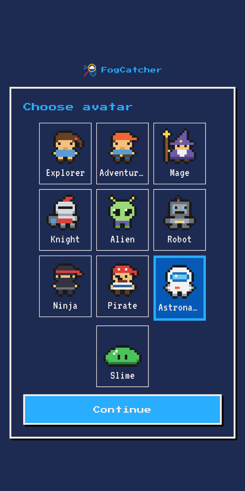
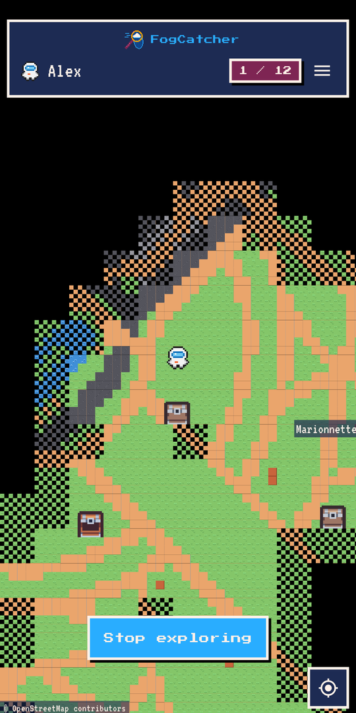
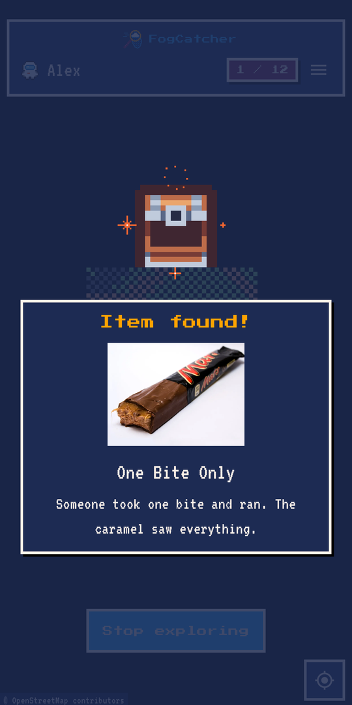
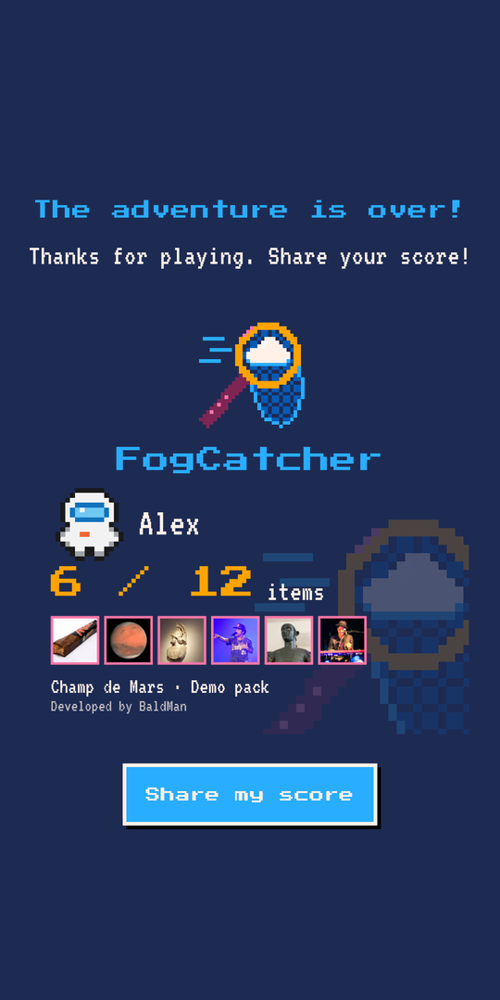

# FogCatcher

[](LICENSE)
[](https://flutter.dev)
[](https://developer.android.com)

Retro-RPG location game for Android. The map of a real place starts hidden under fog; walk around it to clear the fog, reveal a pixel-art map and find the photos hidden at spots across the site. English only.

**FogCatcher is a game to customise, not a finished product.** Bring your own [content pack](#content-packs) to make it yours: app name, event line, colours, logo and icons, the place to explore and the photos to find. Use it for a team event, an offsite, a school trip, a wedding or a city game, under your own brand. The repo ships with a demo pack (Champ de Mars, Paris) so it runs out of the box.

## Screenshots

<p>
  
  
  
  
</p>

## Contents

- [Screenshots](#screenshots)
- [Origin](#origin)
- [Features](#features)
- [Privacy](#privacy)
- [Install](#install)
- [Setup](#setup)
- [Run](#run)
- [Quality gate](#quality-gate)
- [Content packs](#content-packs)
- [New site in one command](#new-site-in-one-command)
- [Solution maps](#solution-maps)
- [Avatars](#avatars)
- [Release](#release)
- [Layout](#layout)
- [Contributing](#contributing)
- [Security](#security)
- [License and credits](#license-and-credits)

## Origin

FogCatcher started as a team game for a company offsite: colleagues walked around the venue's surroundings to clear the fog and hunt for photos hidden across the site, then compared scores at the end of the event. This repo is the generic version: anything specific to that event has been replaced by a swappable content pack and a demo pack.

## Features

- Pixel-art tile map built offline from OpenStreetMap data, revealed as you walk.
- Hidden photo items with a title and short text, found by walking close to them.
- Foreground location service started and stopped only by the player ("Start exploring" / "Stop exploring").
- Avatars, a score card you can share, and an end-of-event score screen.
- Content packs: the app name, event line, palette, brand art, sites and items all come from a swappable pack.

## Privacy

No backend, no account, no analytics. The release build does not declare the `INTERNET` permission: nothing leaves the phone at runtime. Location and progress stay on the device. Only the offline tools under `tool/` use the network (OpenStreetMap downloads).

## Install

There is no public store listing or downloadable APK yet. Build it from source: follow [Setup](#setup), then [Run](#run) with a device or emulator attached. For release builds (signed AAB or APK, Play internal testing for invited testers), see [docs/release.md](docs/release.md).

## Setup

- Flutter 3.44.3, JDK 17, Android SDK 36.
- `flutter pub get && flutter gen-l10n`

## Run

`flutter run` (add `--dart-define=APP_VERSION=x.y.z` to show a version in About; defaults to `dev`).

Debug mode: tap the version label in About 7 times, then enter the PIN. Builds need `--dart-define=DEBUG_PIN_SHA256=<sha256 of the PIN>` (see [docs/release.md](docs/release.md#debug-pin)); without it debug is unreachable. It adds a Debug entry to the map menu (teleport by tapping the map, force-find, reset, force site or game phase).

## Quality gate

`scripts/ci-local.sh` runs format, analyze, complexity metrics, the pack staleness check, tests with coverage and the release build; `--quick` skips the release build and Android lint. CI runs the same script on Flutter 3.44.3.

- `scripts/coverage_gate.py LCOV PREFIX=MIN ...` fails when a path prefix is under its minimum line coverage (a prefix with no lines is reported as n/a).
- `scripts/test_coverage_gate.py` tests the coverage gate itself.

## Content packs

Everything event-specific lives in a content pack: `pack.json` (app name, tagline, event line, event end, default site, palette), brand art (launcher icon, splash, logo, notification glyph), sites and item photos. See [docs/content-packs.md](docs/content-packs.md) for the layout and schema.

- The active pack is `pack/` plus the bundled copies under `assets/`. The repo ships a demo pack: Champ de Mars, Paris, with generated pixel-art branding and 12 freely licensed photos of things called Mars (the planet, the chocolate bar, the Roman god and Bruno Mars), credited in [assets/items/CREDITS.md](assets/items/CREDITS.md).
- Private packs stay out of the repo, in the git-ignored `packs/` directory (or a separate private repo). Apply one with:

  ```sh
  dart run tool/apply_pack.dart packs/<name>
  ```

  It copies the pack into `pack/` and `assets/`, regenerates `lib/config/pack.g.dart`, the launcher icons, splash and notification icons, and updates `pubspec.yaml`. Without an argument it re-applies `pack/`. `--check` only fails when `pack.g.dart` is stale (the gate runs it).

## New site in one command

```sh
dart run tool/new_site.dart --id <id> --name "<display name>" --center <lat>,<lng> --radius <m> --photos <dir> \
  [--captions captions.csv] [--count N] [--spacing M] [--boundary way/<id>|relation/<id>] [--refresh] [--seed <int>]
```

It writes `site.json`, fetches OSM data and builds the tilemap, resizes the photos to WebP (max 960 px), builds the catalogue (titles and texts from a `file,title,text` CSV or from file names), picks item spots, writes `items.json`, registers the site in `assets/sites/index.json` and `pubspec.yaml`, then runs `flutter test test/content`. `--boundary` uses an OSM way or relation as the playable boundary instead of the circle. Details and the lower-level tools: [tool/mapgen/README.md](tool/mapgen/README.md).

## Solution maps

`python3 tool/solution/make_solution_maps.py build/solution` writes answer-key maps (real OSM map with numbered item markers) and a PDF for every site in `assets/sites/index.json` into `build/solution` (git-ignored, never ship them).

## Avatars

`python3 tool/avatars/make_avatars.py [preview.png]` redraws `assets/tiles/avatars.png` (10 original avatars, 2 frames each, order of `lib/models/avatar.dart`) and optionally a 4x preview.

## Release

See [docs/release.md](docs/release.md): upload-key setup, Play internal testing, per-release and hotfix steps. Without `android/key.properties`, release builds fall back to the debug key.

## Layout

`lib/models` (pure data), `lib/game` (pure logic), `lib/services` (interfaces and platform adapters), `lib/config` (constants, theme, generated `pack.g.dart`), `lib/l10n` (ARB + generated), `lib/providers` (Riverpod wiring, `GameController`), `lib/map` (tile map rendering), `lib/widgets` and `lib/screens` (UI; `StartupRouter` picks score, onboarding or map). `tool/` holds the offline content tools, `pack/` the active pack sources.

## Contributing

Issues and pull requests are welcome. See [CONTRIBUTING.md](CONTRIBUTING.md) for setup, the quality gate and the project rules, and follow the [Code of Conduct](CODE_OF_CONDUCT.md).

## Security

Report vulnerabilities privately, not in a public issue. See [SECURITY.md](SECURITY.md).

## License and credits

- Code: MIT, see [LICENSE](LICENSE).
- Map and sprite tiles: Kenney (CC0), see [assets/tiles/LICENSE-kenney.txt](assets/tiles/LICENSE-kenney.txt).
- Fonts: Press Start 2P and VT323, SIL Open Font License, see [assets/fonts/OFL-PressStart2P.txt](assets/fonts/OFL-PressStart2P.txt) and [assets/fonts/OFL-VT323.txt](assets/fonts/OFL-VT323.txt).
- Map data: © OpenStreetMap contributors, available under the Open Database Licence (ODbL).
- Demo item photos: Wikimedia Commons, public domain or CC BY / CC BY-SA by their authors, see [assets/items/CREDITS.md](assets/items/CREDITS.md) for each file's author, licence and source.
- The in-app Licenses page shows these notices too; they are registered in `lib/config/licenses.dart`.
- Developed by BaldMan ([Bald-bearded-man](https://github.com/Bald-bearded-man)).
